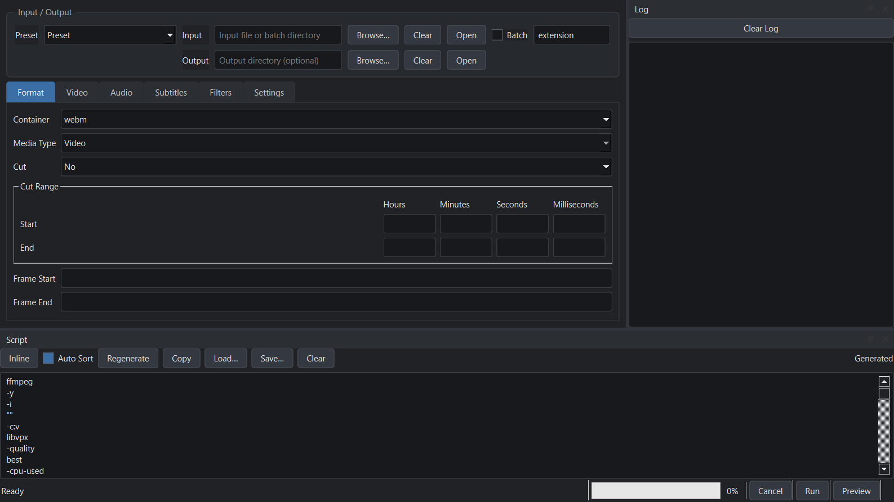
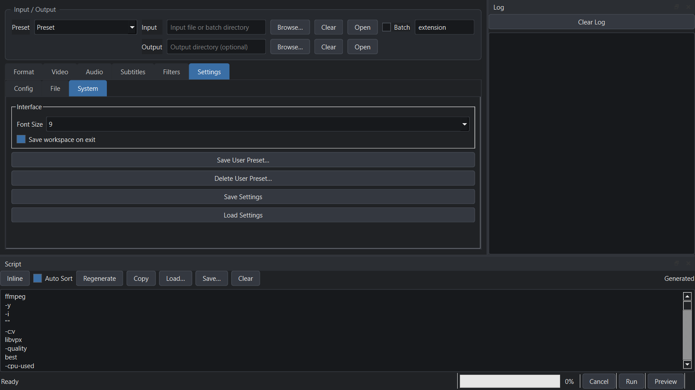

# AxiomPy

[English](README.md) | **简体中文**

[](https://github.com/Riceal28/AxiomPy/actions/workflows/ci.yml)
[](https://www.python.org/)
[](https://doc.qt.io/qtforpython/)
[](https://www.microsoft.com/windows/)
[](LICENSE)

AxiomPy 是一个用于构建、检查和运行 FFmpeg 命令的 Windows 桌面工具。它使用 Python
与 PySide6 重写了 [Matt McManis 的 Axiom](https://github.com/MattMcManis/Axiom)，
重点面向日常转码工作流，而不是要求用户直接编写所有 FFmpeg 参数。



## 功能亮点

- 覆盖常用 FFmpeg 工作流的视频、音频、字幕、滤镜、容器和输出命名选项。
- 支持软件与硬件编码，包括 x264/x265、NVENC、QSV 和 AMF。
- 支持 CRF、VBR、CBR、无损、1-pass 和 2-pass 模式。
- 支持外部音频/字幕混流、流选择、元数据设置和字幕烧录。
- 批处理队列支持逐文件显示 `Pending`、`Running`、`Completed`、`Failed` 和
  `Cancelled` 状态。
- 生成的脚本可编辑、排序、复制、保存和加载，并支持进度、取消及可选外部控制台。
- 内置预设、ffprobe 分析、预览、输入/输出拖放以及 PyInstaller 便携版构建。
- 默认采用 1280x720 布局，支持 8–16 pt 界面字体缩放，并可在退出时选择是否恢复
  完整工作区。
- 选择预设后，预设固定的参数会灰显，并显示可见提示；鼠标悬停可查看原因，
  点击 **Unlock** 可保留当前值并解锁编辑。
- 视频质量、优化、尺寸、音频质量等参数级预设也会让相关参数灰显，并在悬停时
  说明当前控制它们的预设。
- Quality 为 Custom 时支持 CRF、码率、最小/最大码率和缓冲区大小，纯数字码率
  会自动按 kbps 处理。
- 鼠标滚轮调参作为可选项提供，默认关闭，避免误改参数。

## 系统要求

| 组件 | 要求 |
|---|---|
| 操作系统 | Windows 10 或 Windows 11 |
| Python（源码运行） | Python 3.9–3.13 |
| 图形界面 | PySide6 6.9.x |
| FFmpeg | `ffmpeg`、`ffprobe` 和 `ffplay` 位于 `PATH`、在设置中指定，或随便携版打包 |

当前版本以 Windows 为首要支持平台。核心层不依赖 Qt，平台层保留了 POSIX 接口，
但正式发布目标仍是 Windows。
完整便携版内置 **FFmpeg 7.1.1**，其 NVENC API 13.0 兼容 NVIDIA 570.00 或更新的
驱动。FFmpeg 8.x 使用 NVENC API 13.1，要求驱动 610+，因此完整包固定使用 7.1.1。
另有不内置 FFmpeg 的精简包，运行时从 `PATH` 或设置中读取工具路径。

## 快速开始

### 便携版

从 [Releases](https://github.com/Riceal28/AxiomPy/releases) 下载压缩包，解压后运行：

```powershell
.\AxiomPy\AxiomPy.exe
```

每个版本会发布两个 Windows 压缩包：

- `AxiomPy-<version>-win64.zip`：内置 FFmpeg、FFprobe 和 FFplay，推荐直接使用。
- `AxiomPy-<version>-win64-noffmpeg.zip`：不包含这三个工具，体积更小。需要自行
  安装 FFmpeg，将其 `bin` 目录加入 `PATH`，或在 **设置 → Config** 中指定路径。

两个压缩包解压后都包含 `AxiomPy` 目录。若 `AxiomPy.exe` 同级目录存在 `config`
目录，设置和预设会保存在该目录中。

请保持解压后的目录完整：完整包的内置工具位于 `_internal` 子目录中。单独移动
`AxiomPy.exe` 会导致找不到内置 FFmpeg。如果出现
`..\lib\ffmpeg\tools\ffmpeg\bin\ffmpeg.exe` 之类的缺失文件提示，说明运行的是
误将包管理器 shim 打入压缩包的旧版本，请下载 0.2.1 或更新的 Release。

### 从源码运行

克隆仓库后，在项目根目录执行：

```powershell
git clone https://github.com/Riceal28/AxiomPy.git
cd AxiomPy
python -m venv .venv
.\.venv\Scripts\Activate.ps1
python -m pip install --upgrade pip
python -m pip install -e ".[dev]"
python -m axiom
```

安装后也可以使用 `axiom-gui` 启动图形界面。

### 命令行

CLI 使用与一致性测试工具相同的 JSON 用例格式：

```powershell
python -m axiom.cli --case tools/parity_harness/smoke_cases.json --id webm-vp8-crf-25
axiom-cli --case tools/parity_harness/control_cases.json --id ctl-mp4-x264 --print resolved
```

## 使用说明

1. 选择输入文件或批处理目录。
2. 选择容器和可选预设。
3. 配置视频、音频、字幕和滤镜。
4. 在 Script 停靠面板中检查生成的命令。
5. 运行转换，或在外部执行同一命令。

Input/Output 是独立面板。Script 与 Log 停靠窗口可调整大小，其布局也会被工作区快照
保存。

首次启动默认使用 **MP4** 容器，并选择 **all**（全部）音频流。选择预设后，预设
固定的容器、编解码器、质量、流选择和硬件路径会锁定；锁定控件会灰显并在悬停时
说明原因。点击 **Unlock** 可保留当前值并编辑，或选择 `Preset` 回到手动默认值。

参数配置中的预设会单独识别。例如 **Video → Encoding → Quality = High** 会管理
CRF/码率/VBR，**Optimize = Web** 管理 tune/profile/level，**Size = 1080p**
管理宽高，**Audio → Quality = 192** 管理音频码率。灰显标签和控件会在悬停时说明
依赖关系。

### Custom 质量

当 **Quality** 选择 `Custom` 时：

- 码率、最小/最大码率和缓冲区中的纯数字按 kbps 处理（`4500` → `4500K`）。
- 视频编码器使用 `-b:v`，图片编码器使用 `-q:v`。
- CRF 可以与显式码率同时使用。
- 修改 Pass、VBR 或其他控件时不会清空已填写的参数。

### 硬件加速

将 **Video → Encoding → Hardware Acceleration** 设置为 `On` 后，可选择硬件编码器。
**HW Transcode** 会在软件与硬件编码器之间同步切换：

- x264 ↔ H.264 AMF / NVENC / QSV
- x265 ↔ HEVC AMF / NVENC / QSV

硬件质量参数沿用原版 Axiom 的参数表。编码器能否实际使用取决于 GPU 驱动和 FFmpeg
构建；仅检测到编码器并不保证驱动会话一定能够成功创建。

NVENC 使用 `-rc:v vbr_hq` 与 CRF/CQ，QSV 使用 `-global_quality` 和 look-ahead；
AMF 使用原生的 `-rc qvbr -qvbr_quality_level` 选项。H.264 与 HEVC NVENC 命令已由
可选的真实硬件编码测试覆盖。

便携版固定 FFmpeg 7.1.1，避免“驱动报告 NVENC API 13.0、FFmpeg 却要求 13.1”的
不匹配错误。如果驱动版本低于 570.00，请升级驱动、改用 x264/x265，或在
Settings → FFmpeg 中指定兼容的自定义 FFmpeg。

### 工作区与界面设置

打开 **Settings → System** 可配置：

- **Font Size**：8–16 pt，立即应用到整个程序和样式表。
- **Save workspace on exit**：启用后，下次启动会恢复窗口位置与尺寸、停靠布局、
  当前 Tab、编辑后的脚本和转换参数。
- **Mouse wheel adjusts values**：默认关闭；启用后才允许鼠标滚轮直接修改下拉框
  和数值框。

默认窗口大小为 1280x720；如果存在已保存的工作区，则优先使用工作区中的尺寸。

在 **Settings → Config** 中，FFmpeg、FFprobe 和 FFplay 的 `<auto>` 字段下方会显示
实际解析到的路径。使用 **Browse…** 手动选择可执行文件，或点击 **Auto** 恢复
内置/`PATH` 查找。Log File 也提供 **Browse…** 按钮。



## 配置与数据

AxiomPy 使用带版本号的 JSON 配置，不再读取旧的 `axiom.conf` 和 INI 预设。

| 数据 | 位置 |
|---|---|
| 便携版配置 | `<portable>/config/axiom.json` |
| 标准配置 | `%APPDATA%\AxiomPy\axiom.json` |
| 用户预设 | `<config>/presets/*.json` |

如果便携版 `config` 目录存在，会优先使用该目录。设置、预设和工作区快照使用 schema
版本 1，并以 UTF-8 JSON 格式写入。

## 构建便携包

安装打包依赖，并将 FFmpeg 三个可执行文件所在目录告诉构建脚本：

```powershell
python -m pip install -e ".[package]"
$env:AXIOM_FFMPEG_BIN = "C:\ffmpeg\bin"
.\packaging\build.ps1
.\packaging\verify.ps1
```

`build.ps1` 也接受 `-FfmpegBin` 和 `-Python`。未设置 `AXIOM_FFMPEG_BIN` 时，脚本会
尝试从 `PATH` 中查找 `ffmpeg.exe`。脚本会拒绝打包体积很小的包管理器 shim 或带有
`.shim` 伴随文件的启动器，因为这类文件不包含 FFmpeg，移动目录后必然失效。
发布流程会下载固定版本的 FFmpeg 7.1.1、校验 SHA-256 并验证版本。构建会同时生成
`dist\AxiomPy`（带 FFmpeg）和 `dist\AxiomPy-noffmpeg`（不带 FFmpeg）。发布前验证
两个版本：

```powershell
.\packaging\verify.ps1 -Package "dist\AxiomPy"
.\packaging\verify.ps1 -Package "dist\AxiomPy-noffmpeg" -NoFfmpeg
```

完整包会用 `-version` 启动三个内置工具；两个版本都会启动 `AxiomPy.exe` 做冒烟测试。

## 开发

```powershell
python -m pip install -e ".[dev]"
$env:QT_QPA_PLATFORM = "offscreen"
pytest -q
```

当前开发环境的验证结果：

- `371 passed, 8 skipped`
- 可选的 FFmpeg 真实转换测试：`8 passed`，包含 H.264/HEVC NVENC 与 Custom
  CRF/码率/CBR 用例
- 13 个原生 Windows 截图页面全部匹配，差异为 `0.0000%`

### 一致性测试工具

C# oracle 会链接原版 Axiom 的生成器、控制层和编解码器源码，生成逐字节一致的黄金
命令。原仓库不会被修改。

```powershell
$env:AXIOM_REFERENCE_SRC = "C:\src\Axiom\source\Axiom\Axiom"
python tools/parity_harness/build_harness.py
python tools/parity_harness/run_goldens.py
pytest -q
```

构建该工具还需要 .NET Framework 4.7.1 参考程序集环境。

### 真实转换测试

```powershell
$env:AXIOM_RUN_E2E = "1"
$env:AXIOM_FFMPEG_BIN = "C:\ffmpeg\bin"
pytest tests/test_e2e_ffmpeg.py -q
```

### 界面截图回归

```powershell
python tools/ui_snapshots.py
python tools/compare_screenshots.py tests/ui-baseline artifacts/ui-current
```

基线覆盖六个顶层 Tab、相关子 Tab 和 1280x720 下的批处理队列。

## 项目结构

| 路径 | 用途 |
|---|---|
| `src/axiom/core` | 不依赖 Qt 的状态模型、参数生成、预设、配置、探测和进程执行 |
| `src/axiom/platform` | Windows/POSIX 平台抽象 |
| `src/axiom/ui` | PySide6 应用、控件和 Axiom Dark 样式表 |
| `packaging` | PyInstaller 配置、便携版构建和启动验证 |
| `tools/parity_harness` | C# 参考 oracle 和黄金用例生成 |
| `tools/codegen` | 默认值、编解码器、控制层和预设表生成器 |
| `tests` | 单元、控制一致性、黄金命令、界面和可选 FFmpeg 测试 |
| `docs` | 交付状态、界面一致性说明和 README 图片 |

## 已知限制

- YouTube/yt-dlp 下载功能已明确移除。
- 当前版本的界面文案仍为英文，字符串已集中管理，便于后续本地化。
- 当前不提供安装器或代码签名证书。
- QSV/AMF 编码器是否可用取决于本机 GPU 运行时和驱动。
- 无效或不受支持的 FFmpeg 参数仍会由 FFmpeg 报错；AxiomPy 会显示退出码和日志。

## 贡献与安全

开发环境、测试命令和 Pull Request 要求见 [CONTRIBUTING.md](CONTRIBUTING.md)。
安全问题请按照 [SECURITY.md](SECURITY.md) 私下报告。参与项目还需遵守
[CODE_OF_CONDUCT.md](CODE_OF_CONDUCT.md)。

仓库：[github.com/Riceal28/AxiomPy](https://github.com/Riceal28/AxiomPy)

## 许可证与致谢

AxiomPy 使用 GPL-3.0-or-later 许可证，与原版 Axiom 保持一致。详见 [LICENSE](LICENSE)。

本项目基于 Matt McManis 的 Axiom，原作者与本项目没有隶属关系。原 WPF 实现仍作为
独立的参考项目保留。
